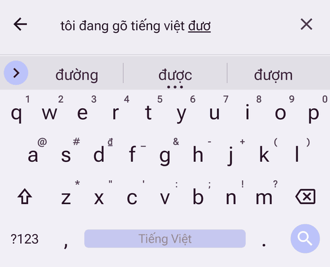
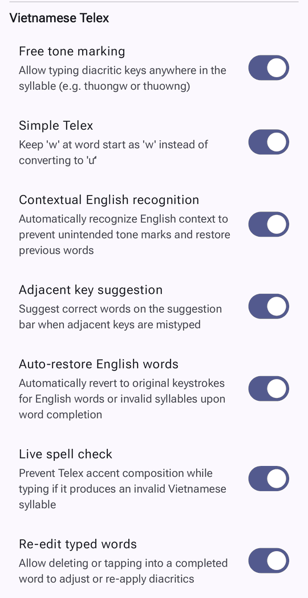
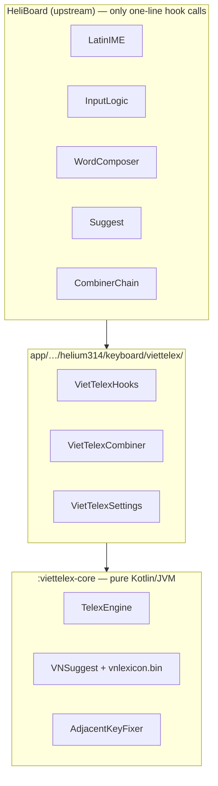

# HeliBoard Telex

<p align="center">
  <strong>English</strong> | <a href="README.vi.md">Tiếng Việt</a>
</p>

<p align="center">
  <strong>Privacy-conscious, 100% offline Android keyboard with an intelligent native Vietnamese Telex engine.</strong>
</p>

<p align="center">
  
  
  
  
</p>

<p align="center">
  
  &nbsp;
  
</p>

---

## 🌟 Overview

**HeliBoard Telex** is an enhanced fork of [HeliBoard](https://github.com/HeliBorg/HeliBoard) (based on OpenBoard / AOSP Keyboard) featuring a **built-in intelligent Vietnamese Telex engine** and a **bundled Vietnamese dictionary**.

Unlike standard AOSP keyboards that rely on basic combiners or require manual dictionary downloads, HeliBoard Telex offers a modern, desktop-class Vietnamese typing experience (inspired by UniKey, OpenKey, and EVKey) directly on Android while keeping the zero-internet privacy guarantee.

The Telex engine, its typing options and the Vietnamese word data come from **[VietTelex](https://github.com/ptrinh/viettelex)** by Phil Trinh, a Vietnamese Telex input method for macOS, iOS and Android. HeliBoard Telex brings that engine into HeliBoard.

---

## ✨ Vietnamese Telex Engine Features

The features and options below follow [VietTelex](https://github.com/ptrinh/viettelex):

* **🎯 Free Diacritic Placement (*Bỏ dấu tự do*)**: Type tone and accent keys at any point within a syllable (e.g. typing `thuongw` or `thuowng` both yield `thương`).
* **🔤 Contextual English Detection (*Quyết định theo ngữ cảnh*)**: Recognizes English phrases to avoid accidental tone marks, and corrects earlier words once a sentence turns out to be English (`his car is very fast` stays as typed).
* **↩️ Auto-Restore English Words (*Tự khôi phục từ Tiếng Anh*)**: At the end of a word, English words and invalid syllables go back to the keys you typed (`text`, `google`, `user`).
* **⚡ Simple Telex (*Telex đơn giản*)**: Keeps `w` at the beginning of a word as `w` (e.g., `web`, `wifi`) instead of auto-converting to `ư`.
* **👆 Adjacent-Key Correction (*Gợi ý sửa lỗi chạm trượt*)**: Detects mistyped neighboring keys and suggests the intended word on the suggestion strip (`cyar` → `của`, `bnaj` → `bạn`). It only suggests, never replaces on its own.
* **🛡️ Live Spell Checking (*Kiểm tra chính tả khi gõ*)**: Stops adding diacritics as soon as the word cannot be Vietnamese (`thanks` does not become `thánk`).
* **✏️ Re-Edit Completed Words (*Sửa dấu từ đã gõ*)**: Backspace into a word, or move the cursor back to it, then add or change its tone (`anh` → `ánh`, `vieet` → `việt`, `tiê` + `ngs` → `tiếng`).
* **📚 Bundled Vietnamese Dictionary**: Includes `main_vi.dict` and `vnlexicon.bin` out of the box—no external dictionary setup required for spellchecking, predictions, and autocorrection.
* **⚙️ Clean Per-Language Settings**: Vietnamese-specific preferences live exclusively within the Vietnamese layout configuration screen (`Settings → Languages & Layouts → Vietnamese`), keeping global preference screens clean and uncluttered.

---

## 🏗️ Architecture

The Vietnamese layer plugs into HeliBoard through its existing **combiner** mechanism (the one used for Korean Hangul and Bengali Khipro), as a new `viet_telex` combiner. It is kept apart from HeliBoard's own code so new HeliBoard versions can be merged with few conflicts.



| Layer | Location | Role |
|---|---|---|
| Engine | `viettelex-core/` | Telex composition, syllable validation, English detection, completions, slip correction. No Android dependency. |
| Glue | `app/src/main/java/helium314/keyboard/viettelex/` | The `viet_telex` combiner, all hook logic, the seven `vn_*` settings and their UI. |
| Hooks | `InputLogic`, `WordComposer`, `Suggest`, `CombinerChain`, `LatinIME`, … | One-line calls into `VietTelexHooks`. HeliBoard's `Settings`, `SettingsValues`, `Defaults` and `strings.xml` are unchanged. |

How a keystroke flows: `InputLogic` → `WordComposer` → `VietTelexCombiner` → `TelexEngine` composes `tieengs` into `tiếng`, which HeliBoard shows as the composing word. At a space or punctuation, the engine decides whether to keep the Vietnamese word or restore the typed keys, and updates the English context.

More detail, with diagrams for every flow (in Vietnamese): [`docs/VIETNAMESE_TELEX.md`](docs/VIETNAMESE_TELEX.md).

### Staying up to date with HeliBoard

`scripts/sync-upstream.sh` merges a HeliBoard branch or release tag and runs the Vietnamese tests. The **Sync upstream HeliBoard** workflow (Actions tab, run manually) does the same on GitHub, builds the APK and opens a pull request, or an issue listing the files if the merge conflicts. Hook points and conflict resolution: [`docs/UPSTREAM_SYNC.md`](docs/UPSTREAM_SYNC.md).

---

## 🔒 Privacy & Core HeliBoard Features

* **100% Offline**: Requires **NO internet permission** in AndroidManifest. Your keystrokes never leave your device.
* **Custom Themes**: Dynamic Material You colors (Android 12+), dark/light theme matching, and full custom color styling.
* **Clipboard History**: Built-in clipboard manager with pinned clips and auto-purge options.
* **Multiple Layouts**: QWERTY, QWERTZ, AZERTY, Dvorak, Colemak, PC layout, and customizable layouts.
* **One-Handed & Split Keyboard**: Ergonomic typing modes for large devices and foldables.
* **Glide Typing**: Compatible with gesture typing libraries extracted from standard GApps packages.
* **Backup & Restore**: Easily export and import your keyboard settings and learned words.

---

## 🚀 Getting Started

### Installation
Download the latest APK (`arm64-v8a`) from the **[Releases](../../releases)** tab or the latest **[Actions Artifacts](../../actions)**.

### Enabling the Keyboard
1. Go to **Settings → System → Languages & Input → On-screen keyboard**.
2. Enable **HeliBoard Telex**.
3. Select **HeliBoard Telex** as your default input method.
4. Open keyboard settings → **Languages & Layouts** → enable **Vietnamese**, then tap it to configure the Telex options.

---

## 🛠️ Building from Source

### Prerequisites
- JDK 17+ (a full JDK with `javac`)
- Android SDK (API 37, Build Tools, NDK)

### Build APK
```bash
# Clone the repository
git clone git@github.com:tecix/HeliBoard-Telex.git
cd HeliBoard-Telex

# Build debug APK (arm64-v8a)
./gradlew assembleDebug
```
The compiled APK will be located at:
`app/build/outputs/apk/debug/HeliBoard-Telex_*-debug.apk`

### Run the Vietnamese tests
```bash
./gradlew :viettelex-core:test :app:testDebugUnitTest \
    --tests 'helium314.keyboard.viettelex.*' --tests 'helium314.keyboard.latin.VietTelexInputLogicTest'
```
Engine tests run on the plain JVM; the others use Robolectric and type through the real `LatinIME`/`InputLogic`.

---

## 📜 License & Credits

- **HeliBoard Telex** is licensed under [GNU General Public License v3.0](LICENSE).
- Portions derived from AOSP Keyboard are licensed under [Apache License 2.0](LICENSE-Apache-2.0).
- Icon licensed under [CC BY-SA 4.0](LICENSE-CC-BY-SA-4.0).
- The Telex engine in `viettelex-core/` is adapted from [VietTelex](https://github.com/ptrinh/viettelex), Copyright (c) 2026 Phil Trinh, [MIT License](viettelex-core/LICENSE).

### Acknowledgements
- [VietTelex](https://github.com/ptrinh/viettelex) / [Phil Trinh](https://github.com/ptrinh) — inspiration, Telex engine, typing options and Vietnamese word data
- [HeliBoard](https://github.com/HeliBorg/HeliBoard) / [Helium314](https://github.com/Helium314)
- [OpenBoard](https://github.com/openboard-team/openboard)
- [AOSP LatinIME](https://android.googlesource.com/platform/packages/inputmethods/LatinIME/)
