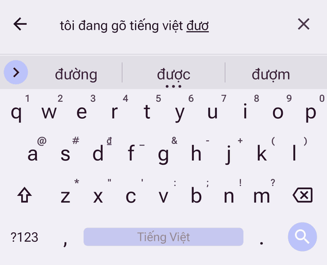
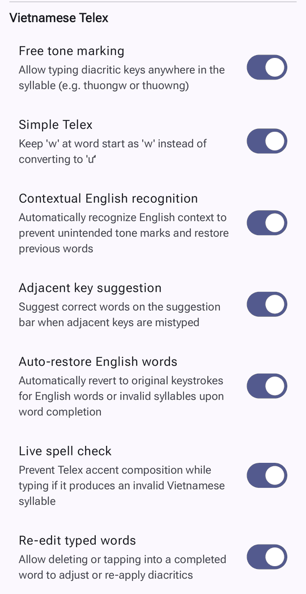
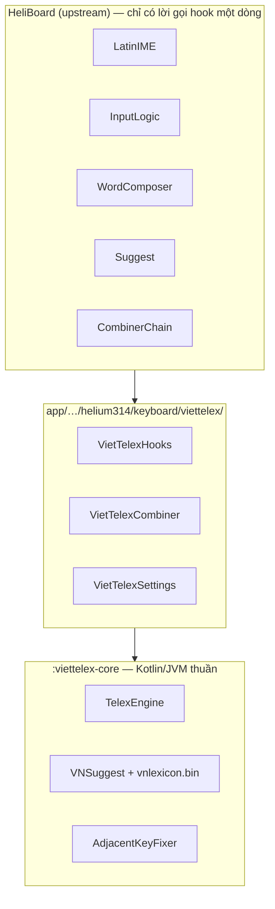

# HeliBoard Telex

<p align="center">
  <a href="README.md">English</a> | <strong>Tiếng Việt</strong>
</p>

<p align="center">
  <strong>Bàn phím Android tôn trọng quyền riêng tư, hoạt động 100% ngoại tuyến, có bộ gõ Telex tiếng Việt thông minh tích hợp sẵn.</strong>
</p>

<p align="center">
  
  
  
  
</p>

<p align="center">
  
  &nbsp;
  
</p>

---

## 🌟 Giới thiệu

**HeliBoard Telex** là bản fork mở rộng của [HeliBoard](https://github.com/HeliBorg/HeliBoard) (dựa trên OpenBoard / bàn phím AOSP), có **bộ gõ Telex tiếng Việt thông minh tích hợp sẵn** và **kèm sẵn từ điển tiếng Việt**.

Khác với các bàn phím AOSP thông thường chỉ có bộ ghép chữ đơn giản hoặc phải tự tải từ điển, HeliBoard Telex mang trải nghiệm gõ tiếng Việt kiểu máy tính (theo tinh thần UniKey, OpenKey, EVKey) lên Android, và vẫn giữ cam kết không dùng Internet.

Bộ gõ Telex, các tùy chọn gõ và dữ liệu từ vựng tiếng Việt lấy từ **[VietTelex](https://github.com/ptrinh/viettelex)** của Phil Trinh — bộ gõ Telex tiếng Việt cho macOS, iOS và Android. HeliBoard Telex đưa bộ gõ đó vào HeliBoard.

---

## ✨ Tính năng gõ Telex

Các tính năng và tùy chọn dưới đây theo [VietTelex](https://github.com/ptrinh/viettelex):

* **🎯 Bỏ dấu tự do**: gõ phím dấu ở bất kỳ vị trí nào trong âm tiết (`thuongw` hay `thuowng` đều ra `thương`).
* **🔤 Quyết định theo ngữ cảnh**: nhận ra câu tiếng Anh để không bỏ dấu nhầm, và sửa lại các từ trước khi câu hóa ra là tiếng Anh (`his car is very fast` giữ nguyên).
* **↩️ Tự khôi phục từ Tiếng Anh**: khi kết thúc từ, từ tiếng Anh hoặc âm tiết không hợp lệ được trả về đúng phím đã gõ (`text`, `google`, `user`).
* **⚡ Telex đơn giản**: `w` ở đầu từ giữ nguyên là `w` (`web`, `wifi`), không đổi thành `ư`.
* **👆 Gợi ý sửa lỗi chạm trượt**: phát hiện phím kề bị bấm nhầm và đề xuất từ đúng trên thanh gợi ý (`cyar` → `của`, `bnaj` → `bạn`). Chỉ đề xuất, không tự thay.
* **🛡️ Kiểm tra chính tả khi gõ**: ngừng ghép dấu ngay khi từ không thể là tiếng Việt (`thanks` không thành `thánk`).
* **✏️ Sửa dấu từ đã gõ**: xóa lùi vào một từ hoặc đưa con trỏ về từ đó, rồi thêm hoặc đổi dấu (`anh` → `ánh`, `vieet` → `việt`, `tiê` + `ngs` → `tiếng`).
* **📚 Kèm sẵn từ điển tiếng Việt**: có `main_vi.dict` và `vnlexicon.bin`, không cần cài thêm từ điển cho kiểm tra chính tả, gợi ý và tự sửa.
* **⚙️ Cài đặt gọn theo ngôn ngữ**: các tùy chọn tiếng Việt chỉ nằm trong màn hình ngôn ngữ Tiếng Việt (`Cài đặt → Languages & Layouts → Vietnamese`), không làm rối các màn hình cài đặt chung.

---

## 🏗️ Kiến trúc

Lớp tiếng Việt gắn vào HeliBoard qua cơ chế **combiner** có sẵn (cơ chế dùng cho tiếng Hàn và tiếng Bengal Khipro), dưới dạng một combiner mới tên `viet_telex`. Lớp này tách khỏi code của HeliBoard để khi HeliBoard ra bản mới, việc gộp ít xung đột.



| Tầng | Vị trí | Vai trò |
|---|---|---|
| Engine | `viettelex-core/` | Ghép dấu Telex, kiểm tra âm tiết, nhận diện tiếng Anh, gợi ý từ, sửa chạm trượt. Không phụ thuộc Android. |
| Lớp keo | `app/src/main/java/helium314/keyboard/viettelex/` | Combiner `viet_telex`, toàn bộ logic hook, 7 tùy chọn `vn_*` và giao diện của chúng. |
| Hook | `InputLogic`, `WordComposer`, `Suggest`, `CombinerChain`, `LatinIME`, … | Lời gọi một dòng vào `VietTelexHooks`. `Settings`, `SettingsValues`, `Defaults` và `strings.xml` của HeliBoard không bị sửa. |

Đường đi của một phím: `InputLogic` → `WordComposer` → `VietTelexCombiner` → `TelexEngine` ghép `tieengs` thành `tiếng`, HeliBoard hiển thị đó là từ đang soạn. Khi gặp dấu cách hay dấu câu, engine quyết định giữ từ tiếng Việt hay trả lại phím đã gõ, và cập nhật ngữ cảnh tiếng Anh.

Chi tiết, có sơ đồ cho từng luồng: [`docs/VIETNAMESE_TELEX.md`](docs/VIETNAMESE_TELEX.md).

### Theo kịp HeliBoard gốc

`scripts/sync-upstream.sh` gộp một nhánh hoặc tag phát hành của HeliBoard rồi chạy test tiếng Việt. Workflow **Sync upstream HeliBoard** (tab Actions, chạy tay) làm việc tương tự trên GitHub: build APK và mở pull request, hoặc mở issue liệt kê các file nếu gộp bị xung đột. Danh sách điểm hook và cách xử lý xung đột: [`docs/UPSTREAM_SYNC.md`](docs/UPSTREAM_SYNC.md).

---

## 🔒 Quyền riêng tư & tính năng gốc của HeliBoard

* **100% ngoại tuyến**: **không xin quyền Internet** trong AndroidManifest. Phím bạn gõ không bao giờ rời khỏi máy.
* **Giao diện tùy biến**: màu động Material You (Android 12+), theo chế độ sáng/tối, tùy chỉnh màu đầy đủ.
* **Lịch sử bộ nhớ tạm**: quản lý clipboard tích hợp, ghim mục và tự xóa.
* **Nhiều bố cục**: QWERTY, QWERTZ, AZERTY, Dvorak, Colemak, bố cục PC và bố cục tự tạo.
* **Bàn phím một tay & tách đôi**: gõ thoải mái trên máy lớn và máy gập.
* **Gõ vuốt**: dùng được với thư viện gõ vuốt lấy từ gói GApps.
* **Sao lưu & khôi phục**: xuất/nhập cài đặt bàn phím và các từ đã học.

---

## 🚀 Bắt đầu

### Cài đặt
Tải APK mới nhất (`arm64-v8a`) ở tab **[Releases](../../releases)** hoặc **[Actions Artifacts](../../actions)** gần nhất.

### Bật bàn phím
1. Vào **Cài đặt → Hệ thống → Ngôn ngữ & nhập liệu → Bàn phím ảo**.
2. Bật **HeliBoard Telex**.
3. Chọn **HeliBoard Telex** làm bàn phím mặc định.
4. Mở cài đặt bàn phím → **Languages & Layouts** → bật **Vietnamese**, rồi chạm vào để chỉnh các tùy chọn Telex.

---

## 🛠️ Build từ mã nguồn

### Yêu cầu
- JDK 17+ (bản JDK đầy đủ, có `javac`)
- Android SDK (API 37, Build Tools, NDK)

### Build APK
```bash
# Tải mã nguồn
git clone git@github.com:tecix/HeliBoard-Telex.git
cd HeliBoard-Telex

# Build APK debug (arm64-v8a)
./gradlew assembleDebug
```
APK nằm ở:
`app/build/outputs/apk/debug/HeliBoard-Telex_*-debug.apk`

### Chạy test tiếng Việt
```bash
./gradlew :viettelex-core:test :app:testDebugUnitTest \
    --tests 'helium314.keyboard.viettelex.*' --tests 'helium314.keyboard.latin.VietTelexInputLogicTest'
```
Test engine chạy trên JVM thuần; các test còn lại dùng Robolectric và gõ qua `LatinIME`/`InputLogic` thật.

---

## 📜 Giấy phép & ghi công

- **HeliBoard Telex** phát hành theo [GNU General Public License v3.0](LICENSE).
- Các phần kế thừa từ bàn phím AOSP theo [Apache License 2.0](LICENSE-Apache-2.0).
- Biểu tượng theo [CC BY-SA 4.0](LICENSE-CC-BY-SA-4.0).
- Bộ gõ Telex trong `viettelex-core/` được chuyển thể từ [VietTelex](https://github.com/ptrinh/viettelex), Copyright (c) 2026 Phil Trinh, [giấy phép MIT](viettelex-core/LICENSE).

### Cảm ơn
- [VietTelex](https://github.com/ptrinh/viettelex) / [Phil Trinh](https://github.com/ptrinh) — nguồn cảm hứng, bộ gõ Telex, các tùy chọn gõ và dữ liệu từ vựng tiếng Việt
- [HeliBoard](https://github.com/HeliBorg/HeliBoard) / [Helium314](https://github.com/Helium314)
- [OpenBoard](https://github.com/openboard-team/openboard)
- [AOSP LatinIME](https://android.googlesource.com/platform/packages/inputmethods/LatinIME/)
