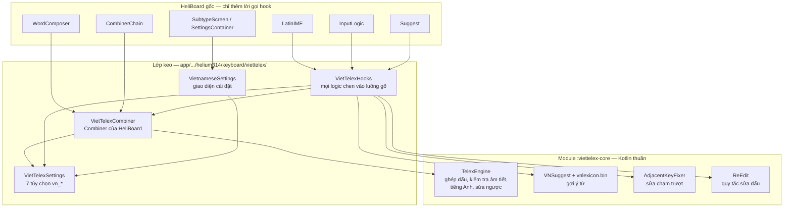
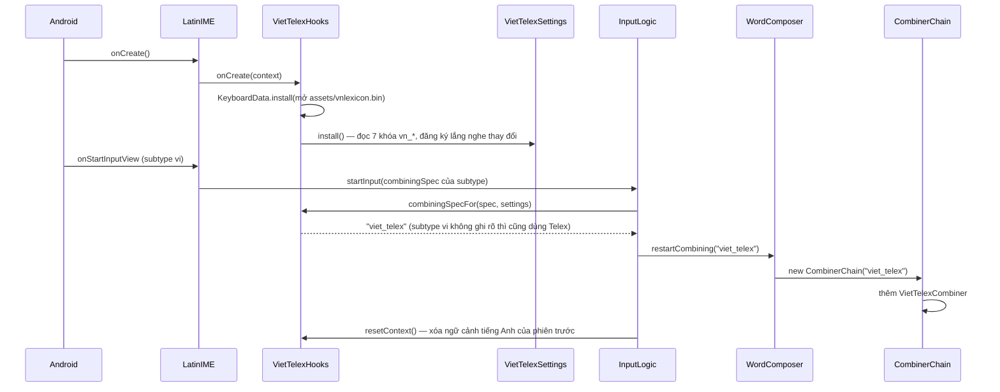
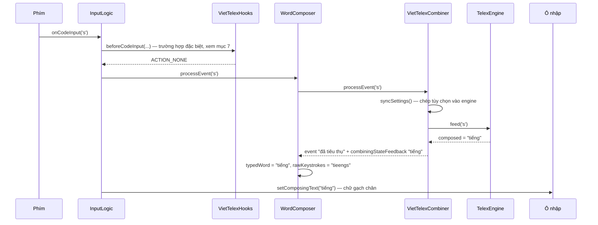
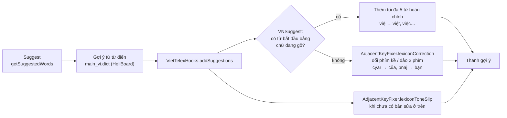
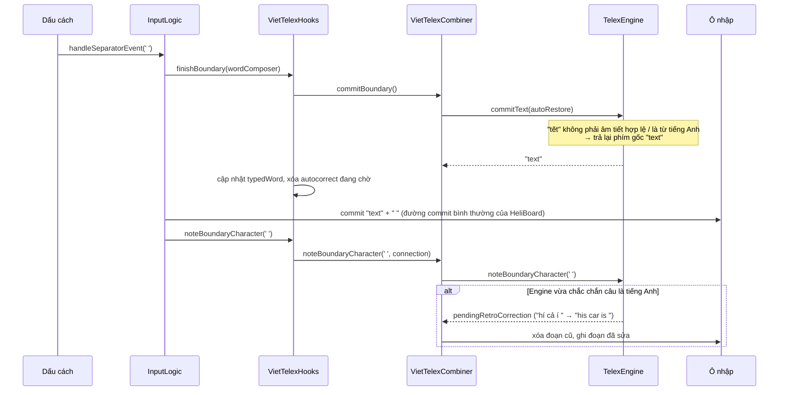
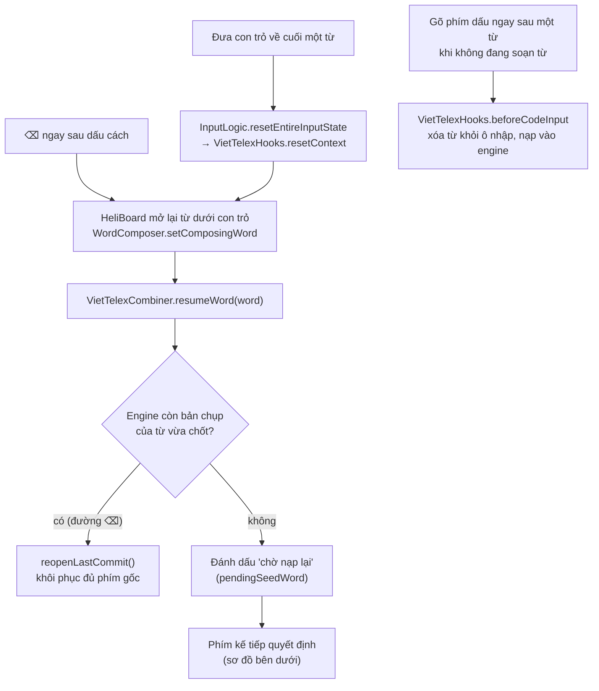
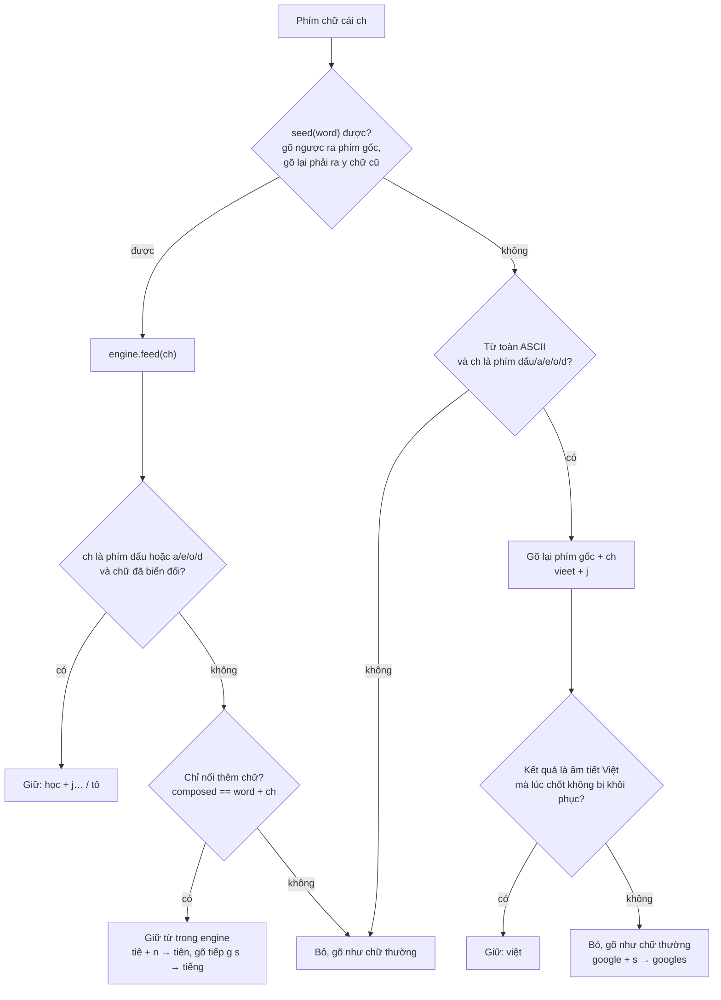
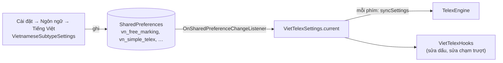
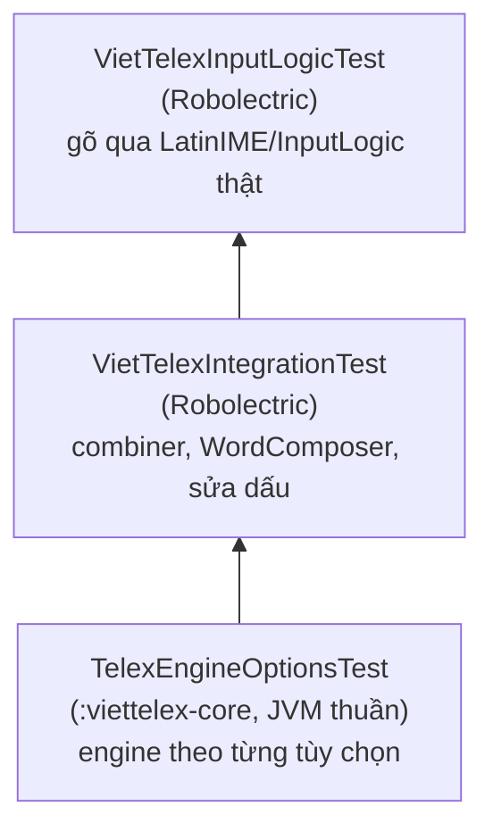
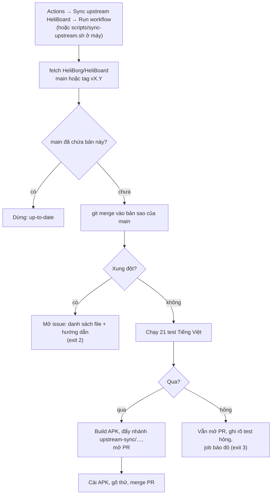

# Cơ chế gõ Tiếng Việt (Telex) trong HeliBoard Telex

Tài liệu này giải thích lớp Tiếng Việt được gắn vào HeliBoard như thế nào, từ lúc bàn phím khởi động
cho tới lúc một từ được ghi vào ô nhập, cùng cách giữ bản fork theo kịp HeliBoard gốc.
Các sơ đồ dùng [Mermaid](https://mermaid.js.org/) — GitHub hiển thị trực tiếp.

Bộ gõ Telex trong `viettelex-core/` và các tùy chọn gõ được chuyển thể từ
[VietTelex](https://github.com/ptrinh/viettelex) của Phil Trinh (giấy phép MIT, xem `viettelex-core/LICENSE`).

Mục lục:
1. [Ý tưởng chính](#1-ý-tưởng-chính)
2. [Ba tầng code](#2-ba-tầng-code)
3. [Khởi động và chọn bộ ghép chữ](#3-khởi-động-và-chọn-bộ-ghép-chữ)
4. [Gõ một phím](#4-gõ-một-phím)
5. [Thanh gợi ý](#5-thanh-gợi-ý)
6. [Kết thúc từ: tự khôi phục và ngữ cảnh tiếng Anh](#6-kết-thúc-từ-tự-khôi-phục-và-ngữ-cảnh-tiếng-anh)
7. [Sửa dấu từ đã gõ](#7-sửa-dấu-từ-đã-gõ)
8. [Cài đặt](#8-cài-đặt)
9. [Bảy tùy chọn nằm ở đâu trong code](#9-bảy-tùy-chọn-nằm-ở-đâu-trong-code)
10. [Kiểm thử](#10-kiểm-thử)
11. [Theo kịp HeliBoard gốc](#11-theo-kịp-heliboard-gốc)

---

## 1. Ý tưởng chính

HeliBoard (kế thừa từ bàn phím AOSP) đã có sẵn khái niệm **combiner** — bộ ghép chữ nằm giữa phím bấm
và chữ hiển thị, đang dùng cho tiếng Hàn (`HangulCombiner`) và tiếng Bengal (`BnKhiproCombiner`).
Tiếng Việt Telex được thêm vào **đúng theo cơ chế đó**: một combiner mới tên `viet_telex`.

Mọi phần "hiểu tiếng Việt" (ghép dấu, kiểm tra âm tiết, nhận diện tiếng Anh, gợi ý) nằm trong một
module Kotlin thuần không phụ thuộc Android. HeliBoard chỉ biết gọi vài **hook** một dòng.

> HeliBoard vẫn lo phần bàn phím: giao diện, từ điển, ghi chữ vào ô nhập, con trỏ.
> Lớp Tiếng Việt chỉ chen vào ở 4 thời điểm — **khởi động, mỗi phím, thanh gợi ý, kết thúc từ** —
> cộng với các đường **sửa dấu từ đã gõ**.

## 2. Ba tầng code



| Tầng | Vị trí | Sửa file của HeliBoard? |
|---|---|---|
| Engine, từ vựng, sửa chạm trượt | `viettelex-core/` | Không |
| Lớp keo | `app/src/main/java/helium314/keyboard/viettelex/` | Không (file riêng) |
| Chuỗi giao diện | `res/values*/strings_viettelex.xml` | Không (file riêng) |
| Lời gọi hook | `InputLogic`, `WordComposer`, `Suggest`, `CombinerChain`, `LatinIME`, … | Có, vài dòng |

Danh sách đầy đủ từng dòng hook: [`UPSTREAM_SYNC.md`](UPSTREAM_SYNC.md#hook-points-in-upstream-files).

## 3. Khởi động và chọn bộ ghép chữ



Subtype tiếng Việt khai báo `CombiningRules=viet_telex` trong `res/xml/method.xml`;
`SubtypeLocaleUtils.getCombiningRulesExtraValue` và `VietTelexHooks.combiningSpecFor` bảo đảm subtype
`vi` do người dùng tự thêm cũng được dùng Telex.

## 4. Gõ một phím

Ví dụ gõ `t i e e n g s`:



Điểm mấu chốt:

- Combiner **nuốt** phím chữ cái: phím không đi thẳng ra màn hình mà vào engine; HeliBoard hiển thị
  chữ engine trả về như một từ đang soạn (composing).
- `WordComposer` giữ thêm **chuỗi phím gốc** (`tieengs`) — gợi ý và sửa chạm trượt cần nó.
- Ký tự không phải chữ cái (số, dấu nối) khiến engine chốt phần đang ghép rồi nối ký tự vào sau.
- Ô mật khẩu và ô kiểu "null" không đi qua engine.

## 5. Thanh gợi ý



Sửa chạm trượt chỉ **đề xuất** trên thanh gợi ý, không tự thay chữ. Tắt "Gợi ý sửa lỗi chạm trượt"
thì bỏ hai nhánh `AdjacentKeyFixer`.

## 6. Kết thúc từ: tự khôi phục và ngữ cảnh tiếng Anh



- **Tự khôi phục từ Tiếng Anh**: lúc chốt từ, nếu kết quả không phải âm tiết Việt hợp lệ hoặc là từ
  tiếng Anh đã biết, engine trả lại đúng phím gốc (`text`, `google`, `user`).
- **Quyết định theo ngữ cảnh**: engine nhớ vài từ gần nhất. Khi một "mạch" tiếng Anh trở nên chắc chắn
  (`very`, `the`…), nó sửa ngược các từ trước đã bị bỏ dấu nhầm. Chỉ chạy khi bật cả tùy chọn này
  lẫn "Tự khôi phục"; dấu chấm, xuống dòng hay di chuyển con trỏ sẽ xóa ngữ cảnh.

## 7. Sửa dấu từ đã gõ

Có ba đường đưa một từ đã xong trở lại engine:



Khi từ đang "chờ nạp lại", phím kế tiếp được xử lý như sau:



Tắt "Sửa dấu từ đã gõ" thì từ được mở lại ở trạng thái **khóa**: mọi chữ gõ thêm chỉ được nối vào,
không ghép dấu.

## 8. Cài đặt



- Bảy khóa `vn_*` được đọc trực tiếp; `Settings`, `SettingsValues`, `Defaults` của HeliBoard không đổi.
- Thay đổi có hiệu lực ngay nhờ bộ lắng nghe.
- `VietTelexSettings.current` bằng `null` khi chưa cài (trong unit test thuần JVM); code coi `null`
  là "dùng hành vi mặc định".

## 9. Bảy tùy chọn nằm ở đâu trong code

| Tùy chọn | Khóa | Có tác dụng ở |
|---|---|---|
| Bỏ dấu tự do | `vn_free_marking` | `TelexEngine.freeMarking` — mỗi phím |
| Telex đơn giản | `vn_simple_telex` | `TelexEngine.simpleTelex` — `w` đầu từ giữ nguyên |
| Quyết định theo ngữ cảnh | `vn_contextual_english` | `contextualEnglish` + `retroactiveEnglish`; sửa ngược ở `noteBoundaryCharacter` |
| Gợi ý sửa lỗi chạm trượt | `vn_auto_fix_adjacent` | `VietTelexHooks.addSuggestions` |
| Tự khôi phục từ Tiếng Anh | `vn_auto_restore` | `commitText(autoRestore)` lúc chốt từ, `eagerEnglishRestore` |
| Kiểm tra chính tả khi gõ | `vn_live_spell_check` | `TelexEngine.liveSpellCheck` — dừng ghép dấu khi không thể là tiếng Việt |
| Sửa dấu từ đã gõ | `vn_re_edit_words` | `beforeCodeInput`, `reopenAfterDelete`, `resumeWord` |

## 10. Kiểm thử



| Lớp test | Bắt được |
|---|---|
| Engine | Sai luật ghép dấu, kiểm tra âm tiết, tiếng Anh |
| Combiner | Sai cách combiner nạp/mở lại từ, đồng bộ cài đặt |
| InputLogic | **Hook ngừng được gọi** sau khi HeliBoard đổi luồng gõ — lớp quan trọng nhất khi cập nhật upstream (gỡ thử hook `finishBoundary` làm 3 test đỏ) |

Chạy:

```sh
./gradlew :viettelex-core:test :app:testDebugUnitTest \
    --tests 'helium314.keyboard.viettelex.*' --tests 'helium314.keyboard.latin.VietTelexInputLogicTest'
```

## 11. Theo kịp HeliBoard gốc



Khi xung đột: lấy code của HeliBoard, rồi đặt lại các dòng `VietTelexHooks…` theo danh sách trong
[`UPSTREAM_SYNC.md`](UPSTREAM_SYNC.md). Không đưa logic Tiếng Việt trở lại file của HeliBoard.
